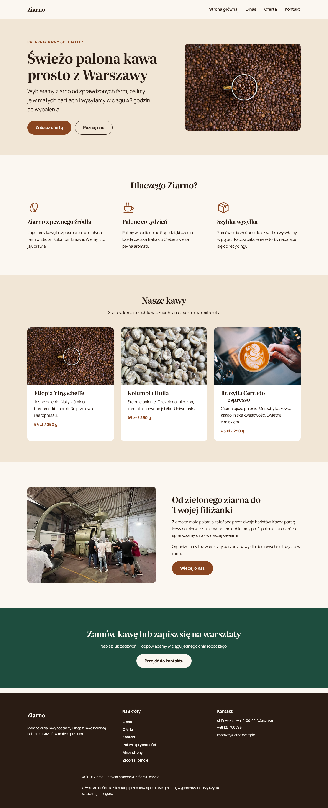
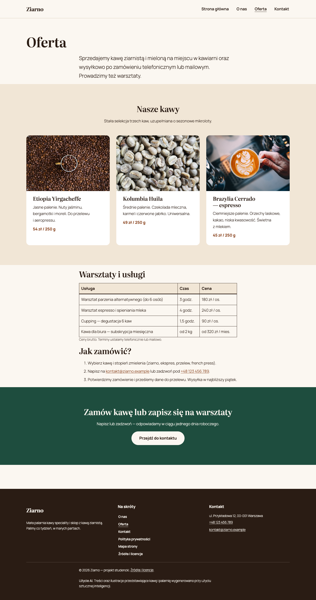
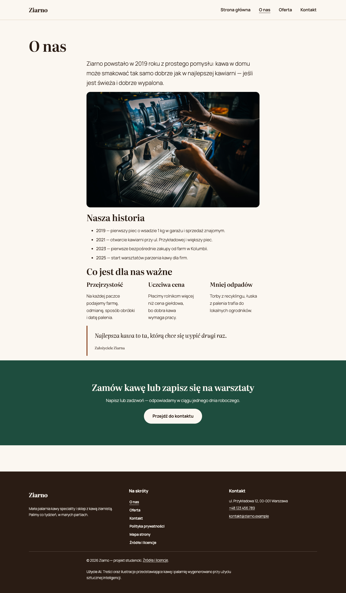
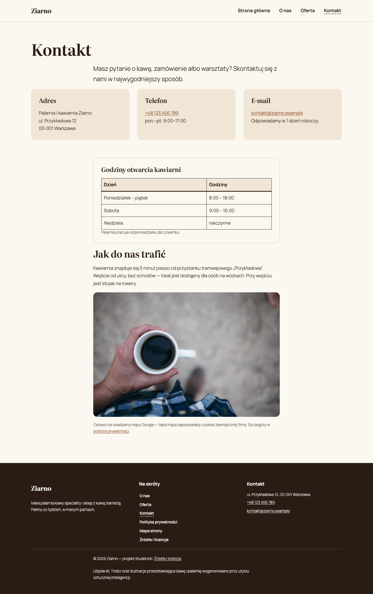

# Ziarno — projekt MP1

Przygotowałem stronę fikcyjnej palarni kawy Ziarno w WordPressie. Strona przedstawia firmę, jej ofertę i dane kontaktowe.

## Podstrony i cookies

W działającej witrynie sprawdziłem siedem opublikowanych widoków: Start (`/`), Oferta (`/oferta/`), O nas (`/o-nas/`), Kontakt (`/kontakt/`), Polityka prywatności (`/polityka-prywatnosci/`), Mapa strony (`/mapa-strony/`) oraz Źródła i licencje (`/zrodla-i-licencje/`).

Przy pierwszej wizycie wyświetla się informacja o cookies z linkiem do Polityki prywatności. Po kliknięciu „Rozumiem” wybór jest zapamiętywany w pamięci przeglądarki (`localStorage`).

## Uruchomienie w Local

1. Utwórz nową instalację WordPressa w Local i uruchom ją. Jeżeli możesz, nadaj jej domenę `studia-sklep.local`. Otwórz z panelu Local **Site Shell**.
2. Do katalogu `app/public/` nowej instalacji skopiuj pliki z [`app/public/`](app/public) tego projektu z pominięciem `wp-config.php`. Zachowaj konfigurację połączenia i konto administratora nowej instalacji. Eksport korzysta z prefiksu tabel `wp_`; sprawdź, czy nowa instalacja używa tego samego prefiksu.
3. W **Site Shell** zaimportuj [`app/sql/ziarno.sql`](app/sql/ziarno.sql) poleceniem `wp db import "/pełna/ścieżka/do/projektu/app/sql/ziarno.sql"`. Import zastępuje tabele treści i ustawień. Plik pomija tabele kont i ich metadanych, więc do logowania użyj konta z nowej instalacji.
4. Jeśli używasz innej domeny, uruchom `wp search-replace 'http://studia-sklep.local' 'http://twoja-domena.local' --skip-columns=guid`. Wstaw rzeczywisty adres wraz z właściwym protokołem. Ustaw adres e-mail administratora w panelu WordPressa, a następnie zapisz ustawienia w **Ustawienia → Bezpośrednie odnośniki**.
5. Otwórz stronę główną i sprawdź menu, ilustracje oraz link do polityki prywatności w banerze cookies.

## Decyzje projektowe

Wykorzystałem motyw Twenty Twenty-Five oraz motyw potomny Ziarno. Wybrałem kremowe tło, ciemny brąz i zielone akcenty, aby nawiązać do kawy i naturalnego charakteru marki. Zastosowałem **Manrope** do tekstu podstawowego i **Literatę** do nagłówków. Pliki obu fontów są przechowywane lokalnie.

| Kolor | Kod HEX | Rola w motywie |
| --- | --- | --- |
| Krem | `#FBF7F1` | Główne tło i jasny tekst na ciemnym tle |
| Espresso | `#2A1C14` | Tekst podstawowy i tło stopki |
| Rdzawy brąz | `#8A4520` | Akcent przycisków, cen i fokusu |
| Latte | `#F1E6D6` | Jasne tło wyróżnionych elementów |
| Butelkowa zieleń | `#1E4D3E` | Tło sekcji z wezwaniem do działania |
| Ciepła szarość | `#5E5049` | Dodatkowy kolor tekstu i separator w stopce |
| Biel | `#FFFFFF` | Dodatkowy kolor w palecie |
| Beż | `#D9C9B4` | Obramowania i linie |

Kod motywu potomnego znajduje się w [`app/public/wp-content/themes/ziarno`](app/public/wp-content/themes/ziarno), a paletę i typografię zdefiniowałem w [`theme.json`](app/public/wp-content/themes/ziarno/theme.json).

## Użycie AI

Claude AI wykorzystałem do wygenerowania tekstów oraz ilustracji kawy i palarni. ChatGPT wykorzystałem do poprawy gramatyki i uporządkowania struktury README.

W stopce oznaczyłem pochodzenie tekstów i ilustracji. W wykazie źródeł zaktualizowałem informacje o pochodzeniu grafik i ich licencjach. Szczegółowy zakres ręcznych poprawek tekstów i ilustracji pozostaje nieudokumentowany.

## Źródła materiałów i licencje

| Materiał | Źródło i zastosowanie | Licencja lub status |
| --- | --- | --- |
| `ziarna.jpg`, `zielona.jpg`, `latte.jpg`, `palarnia.jpg`, `barista.jpg`, `filizanka.jpg` | Claude AI, pliki w `assets/images/` motywu Ziarno | Dokładny generator obrazów i jego warunki użycia wymagają potwierdzenia. |
| Treści witryny | Claude AI | Brak udokumentowanej osobnej licencji. |
| `ziarno.svg`, `filizanka.svg`, `paczka.svg` | Ikony sekcji „Dlaczego Ziarno?”, zapisane w `assets/icons/`. Wykaz projektu opisuje je jako opracowanie własne. | [CC0 1.0](https://creativecommons.org/publicdomain/zero/1.0/) według wykazu projektu |
| Manrope | Mikhail Sharanda, lokalna kopia fontu z motywu Twenty Twenty-Five | [SIL Open Font License 1.1](https://github.com/google/fonts/blob/main/ofl/manrope/OFL.txt) |
| Literata | TypeTogether, lokalna kopia fontu z motywu Twenty Twenty-Five | [SIL Open Font License 1.1](https://github.com/google/fonts/blob/main/ofl/literata/OFL.txt) |
| WordPress i ikony mobilnego bloku Nawigacja | WordPress, ikony otwierania i zamykania menu | [GNU GPL v2 lub nowsza](app/public/license.txt) |
| Motywy Twenty Twenty-Five i Ziarno | Motyw nadrzędny oraz motyw potomny projektu | GNU GPL v2 lub nowsza według nagłówków arkuszy stylów |

## Raport dostępności

22 listopada 2026 r. uruchomiłem **Lighthouse 12.6.1** w trybie mobilnym dla strony głównej `http://studia-sklep.local/`. Wynik kategorii dostępności to **100/100**. Raport HTML zawiera szczegóły automatycznych testów. [Otwórz raport Lighthouse](raport-dostepnosci-lighthouse.html).

**Przegląd kodu i HTML** z 22 listopada 2026 r. obejmował kod motywu Ziarno oraz wygenerowany HTML strony głównej i podstrony „Źródła i licencje”. Kryteria odniesienia pochodzą z [WCAG 2.2](https://www.w3.org/TR/WCAG22/).

| Obszar | Wynik przeglądu |
| --- | --- |
| Teksty alternatywne (1.1.1) | Ilustracje na stronie głównej mają opisowe atrybuty `alt`. Trzy dekoracyjne ikony mają `alt=""`, a ich znaczenie przekazują sąsiadujące nagłówki. |
| Struktura i język (1.3.1, 3.1.1) | Sprawdzone strony mają `lang="pl-PL"`, obszar `main` oraz etykiety „Menu główne” i „Menu w stopce”. Wzorzec strony głównej używa nagłówków H1, H2 i H3 zgodnie ze strukturą sekcji. |
| Pomijanie nawigacji i fokus (2.4.1, 2.4.7) | W HTML obu stron link pomijający nawigację prowadzi do istniejącego elementu `main`. CSS określa obrys `:focus-visible` i jasny wariant na ciemnym tle. |
| Kontrast tekstu (1.4.3) | Obliczony kontrast kremu `#FBF7F1` z espresso `#2A1C14` wynosi 15,44:1, z rdzawym brązem `#8A4520` 6,66:1, a z zielenią `#1E4D3E` 9,00:1. W Chrome sprawdziłem obliczone kolory aktywnych linków stopki na sześciu podstronach. Kremowy tekst `#FBF7F1` na tle espresso `#2A1C14` daje 15,44:1 przy wymaganym minimum 4,5:1. |
| Kolejność fokusu i menu mobilne (2.1.1, 2.4.3) | Na stronie głównej przy szerokości 320 px pierwszy Tab prowadzi do linku „Przejdź do treści”. Po aktywacji linku kolejny Tab przenosi fokus do treści głównej. Menu można otworzyć klawiszem Enter. Tab przechodzi między elementami menu, a Escape zamyka menu i przywraca fokus na przycisk otwierania. |
| Baner cookies (2.1.1, 2.4.11) | Test przy 320 px wykazał, że baner zasłaniał aktywne linki. Po przeniesieniu pod nagłówek baner nie zasłania linków w sprawdzonym przebiegu. Tab prowadzi do linku do polityki i do przycisku „Rozumiem”. Enter zamyka baner, a wybór jest zapisywany w `localStorage`. |
| Powiększenie i małe ekrany (1.4.4, 1.4.10) | Na siedmiu podstronach sprawdziłem szerokość 320 px CSS oraz powiększenie przeglądarki do 200% i 400% przy oknie o szerokości 1280 px. W żadnym pomiarze dokument nie wymagał przewijania poziomego. Szerokie tabele przewijają się we własnych obszarach. |
| Semantyka dla technologii asystujących (1.1.1, 1.3.1) | W drzewie dostępności Chrome sprawdziłem obszar główny i nagłówek H1 na wszystkich siedmiu stronach oraz role i nazwy przykładowych linków, ilustracji i tabel. Wynik dotyczy danych udostępnianych przez przeglądarkę technologiom asystującym. |

W motywie zastosowałem opisowe teksty alternatywne ilustracji, pusty atrybut `alt` ikon dekoracyjnych oraz widoczny obrys fokusu.

## Materiały do oddania

- [Pliki WordPressa](app/public), [eksport bazy danych](app/sql/ziarno.sql) i [instrukcja uruchomienia](#uruchomienie-w-local).
- Pełnostronicowe zrzuty w widoku komputerowym znajdują się w katalogu [`zrzuty-ekranu/`](zrzuty-ekranu/). [Strona główna](zrzuty-ekranu/01-strona-glowna.png), [Oferta](zrzuty-ekranu/02-oferta.png), [O nas](zrzuty-ekranu/03-o-nas.png), [Kontakt](zrzuty-ekranu/04-kontakt.png).
- [Raport Lighthouse w formacie HTML](raport-dostepnosci-lighthouse.html).
- Dokumentacja decyzji projektowych, źródeł materiałów, licencji i użycia AI znajduje się w tym README.

## Zrzuty ekranu

### Strona główna

### Oferta

### O nas

### Kontakt

